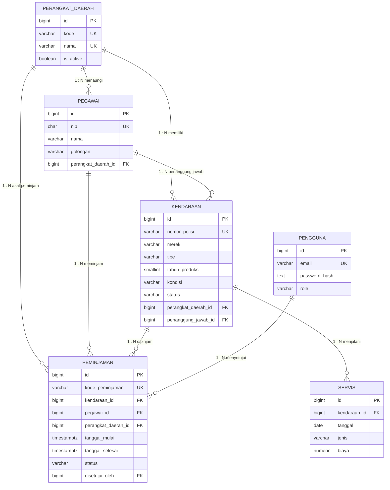

# ERD & Rancangan Database — Aplikasi KDO

**Versi:** 1.0
**Tanggal:** 10 November 2026
**Database:** PostgreSQL 16
**Terkait:** [`prd.md`](prd.md) · [`product-overview.md`](product-overview.md) · [`../Agents.md`](../Agents.md)

---

## 1. Konvensi Skema

| Aspek | Ketentuan |
| --- | --- |
| Nama tabel | `snake_case`, bentuk tunggal (`kendaraan`, bukan `kendaraans`) |
| Primary key | `id BIGSERIAL` |
| Foreign key | `<entitas>_id BIGINT` |
| Waktu | `timestamptz`, default `now()` |
| Uang | `numeric(14,2)` |
| Soft delete | `deleted_at timestamptz NULL` |
| Enum | `varchar` + `CHECK` (bukan tipe ENUM PostgreSQL, agar mudah ditambah) |
| Penamaan constraint | `chk_`, `uq_`, `fk_`, `idx_`, `excl_` |
| Normalisasi | Nomor polisi & kode instansi uppercase, email lowercase |

**Alasan `varchar + CHECK`:** menambah nilai enum cukup mengubah constraint, tanpa
`ALTER TYPE` yang merepotkan saat migrasi. sqlc memetakannya menjadi `string`.

---

## 2. Diagram Relasi



### Kardinalitas

| Relasi | Kardinalitas | Wajib? | Catatan |
| --- | --- | --- | --- |
| Perangkat daerah → Pegawai | 1 : N | Pegawai wajib punya OPD | `ON DELETE RESTRICT` |
| Perangkat daerah → Kendaraan | 1 : N | Kendaraan wajib punya OPD | `ON DELETE RESTRICT` |
| Perangkat daerah → Peminjaman | 1 : N | Wajib | Denormalisasi untuk pelaporan |
| Pegawai → Kendaraan (penanggung jawab) | 1 : N | Opsional | `ON DELETE SET NULL` |
| Pegawai → Peminjaman | 1 : N | Wajib | `ON DELETE RESTRICT` |
| Kendaraan → Peminjaman | 1 : N | Wajib | `ON DELETE RESTRICT` |
| Kendaraan → Servis | 1 : N | Wajib | `ON DELETE CASCADE` (hard delete) |
| Pengguna → Peminjaman (penyetuju) | 1 : N | Opsional | `ON DELETE SET NULL` |

> Karena aplikasi memakai **soft delete**, `ON DELETE` hanya berlaku untuk pembersihan
> manual oleh admin database. Aturan bisnis penghapusan tetap divalidasi di service layer.

---

## 3. Detail Tabel

### 3.1 `perangkat_daerah`

| Kolom | Tipe | Null | Default | Constraint |
| --- | --- | --- | --- | --- |
| id | bigserial | tidak | — | PK |
| kode | varchar(20) | tidak | — | unik (aktif), `kode = upper(kode)` |
| nama | varchar(150) | tidak | — | unik (aktif) |
| singkatan | varchar(30) | ya | — | — |
| alamat | text | ya | — | — |
| telepon | varchar(20) | ya | — | — |
| email | varchar(100) | ya | — | format sederhana `%_@_%._%` |
| nama_kepala | varchar(100) | ya | — | — |
| is_active | boolean | tidak | `true` | — |
| created_at | timestamptz | tidak | `now()` | — |
| updated_at | timestamptz | tidak | `now()` | trigger |
| deleted_at | timestamptz | ya | `NULL` | soft delete |

### 3.2 `pegawai`

| Kolom | Tipe | Null | Default | Constraint |
| --- | --- | --- | --- | --- |
| id | bigserial | tidak | — | PK |
| nip | char(18) | tidak | — | unik (aktif), `^[0-9]{18}$` |
| nama | varchar(100) | tidak | — | — |
| gelar_depan | varchar(20) | ya | — | — |
| gelar_belakang | varchar(30) | ya | — | — |
| jabatan | varchar(100) | tidak | — | — |
| golongan | varchar(10) | tidak | — | `chk_pegawai_golongan` |
| pangkat | varchar(50) | ya | — | — |
| perangkat_daerah_id | bigint | tidak | — | FK → `perangkat_daerah.id` |
| email | varchar(100) | ya | — | format email |
| telepon | varchar(20) | ya | — | — |
| tanggal_lahir | date | ya | — | `>= 1945-01-01` |
| status_pegawai | varchar(20) | tidak | `'aktif'` | `aktif`, `nonaktif`, `pensiun` |
| created_at | timestamptz | tidak | `now()` | — |
| updated_at | timestamptz | tidak | `now()` | trigger |
| deleted_at | timestamptz | ya | `NULL` | soft delete |

### 3.3 `kendaraan`

| Kolom | Tipe | Null | Default | Constraint |
| --- | --- | --- | --- | --- |
| id | bigserial | tidak | — | PK |
| nomor_polisi | varchar(15) | tidak | — | unik (aktif), format `AA 1234 BBB` |
| nomor_rangka | varchar(50) | ya | — | unik (aktif) bila diisi |
| nomor_mesin | varchar(50) | ya | — | unik (aktif) bila diisi |
| merek | varchar(50) | tidak | — | — |
| tipe | varchar(50) | tidak | — | — |
| tahun_produksi | smallint | tidak | — | 1980–2100 (validasi atas: tahun+1) |
| warna | varchar(30) | tidak | — | — |
| jenis | varchar(20) | tidak | — | `motor`, `mobil`, `minibus`, `pickup`, `ambulans` |
| bahan_bakar | varchar(20) | tidak | `'bensin'` | `bensin`, `solar`, `listrik`, `hybrid` |
| kapasitas_cc | integer | ya | — | `>= 0` |
| odometer_km | integer | tidak | `0` | `>= 0` |
| kondisi | varchar(20) | tidak | `'baik'` | `baik`, `rusak_ringan`, `rusak_berat` |
| status | varchar(20) | tidak | `'tersedia'` | `tersedia`, `digunakan`, `perbaikan`, `dihapuskan` |
| tanggal_pajak | date | ya | — | — |
| tanggal_stnk | date | ya | — | — |
| perangkat_daerah_id | bigint | tidak | — | FK → `perangkat_daerah.id` |
| penanggung_jawab_id | bigint | ya | — | FK → `pegawai.id` |
| foto_url | text | ya | — | — |
| keterangan | text | ya | — | — |
| created_at | timestamptz | tidak | `now()` | — |
| updated_at | timestamptz | tidak | `now()` | trigger |
| deleted_at | timestamptz | ya | `NULL` | soft delete |

### 3.4 `peminjaman`

| Kolom | Tipe | Null | Default | Constraint |
| --- | --- | --- | --- | --- |
| id | bigserial | tidak | — | PK |
| kode_peminjaman | varchar(30) | tidak | — | unik, `^PJM-[0-9]{8}-[0-9]{4}$` |
| kendaraan_id | bigint | tidak | — | FK → `kendaraan.id` |
| pegawai_id | bigint | tidak | — | FK → `pegawai.id` |
| perangkat_daerah_id | bigint | tidak | — | FK → `perangkat_daerah.id` |
| keperluan | varchar(200) | tidak | — | — |
| tujuan | varchar(200) | tidak | — | — |
| tanggal_mulai | timestamptz | tidak | — | — |
| tanggal_selesai | timestamptz | tidak | — | `> tanggal_mulai` |
| status | varchar(20) | tidak | `'diajukan'` | `diajukan`, `disetujui`, `ditolak`, `selesai`, `dibatalkan` |
| catatan | text | ya | — | — |
| disetujui_oleh | bigint | ya | — | FK → `pengguna.id` |
| created_at | timestamptz | tidak | `now()` | — |
| updated_at | timestamptz | tidak | `now()` | trigger |
| deleted_at | timestamptz | ya | `NULL` | soft delete (tidak dipakai API) |

### 3.5 `servis`

| Kolom | Tipe | Null | Default | Constraint |
| --- | --- | --- | --- | --- |
| id | bigserial | tidak | — | PK |
| kendaraan_id | bigint | tidak | — | FK → `kendaraan.id` |
| tanggal | date | tidak | — | — |
| jenis | varchar(30) | tidak | — | `rutin`, `perbaikan`, `ganti_part` |
| deskripsi | text | tidak | — | — |
| bengkel | varchar(100) | ya | — | — |
| biaya | numeric(14,2) | tidak | `0` | `>= 0` |
| odometer_km | integer | ya | — | `>= 0` |
| created_at | timestamptz | tidak | `now()` | — |
| updated_at | timestamptz | tidak | `now()` | trigger |
| deleted_at | timestamptz | ya | `NULL` | soft delete |

### 3.6 `pengguna`

| Kolom | Tipe | Null | Default | Constraint |
| --- | --- | --- | --- | --- |
| id | bigserial | tidak | — | PK |
| nama | varchar(100) | tidak | — | — |
| email | varchar(100) | tidak | — | unik (case-insensitive, aktif) |
| password_hash | text | tidak | — | bcrypt |
| role | varchar(20) | tidak | `'operator'` | `admin`, `operator`, `pimpinan` |
| is_active | boolean | tidak | `true` | — |
| created_at | timestamptz | tidak | `now()` | — |
| updated_at | timestamptz | tidak | `now()` | trigger |
| deleted_at | timestamptz | ya | `NULL` | soft delete |

---

## 4. Nilai Enum

| Kolom | Nilai |
| --- | --- |
| `pegawai.golongan` | `I/a` … `I/d`, `II/a` … `II/d`, `III/a` … `III/d`, `IV/a` … `IV/e` |
| `pegawai.status_pegawai` | `aktif`, `nonaktif`, `pensiun` |
| `kendaraan.jenis` | `motor`, `mobil`, `minibus`, `pickup`, `ambulans` |
| `kendaraan.bahan_bakar` | `bensin`, `solar`, `listrik`, `hybrid` |
| `kendaraan.kondisi` | `baik`, `rusak_ringan`, `rusak_berat` |
| `kendaraan.status` | `tersedia`, `digunakan`, `perbaikan`, `dihapuskan` |
| `peminjaman.status` | `diajukan`, `disetujui`, `ditolak`, `selesai`, `dibatalkan` |
| `servis.jenis` | `rutin`, `perbaikan`, `ganti_part` |
| `pengguna.role` | `admin`, `operator`, `pimpinan` |

---

## 5. Index

| Nama | Tabel | Kolom | Jenis | Tujuan |
| --- | --- | --- | --- | --- |
| `uq_pd_kode` | perangkat_daerah | `lower(kode)` | unik parsial | Cegah duplikat kode |
| `uq_pd_nama` | perangkat_daerah | `lower(nama)` | unik parsial | Cegah duplikat nama |
| `uq_pegawai_nip` | pegawai | `nip` | unik parsial | NIP unik |
| `idx_pegawai_pd` | pegawai | `perangkat_daerah_id` | btree | Filter OPD |
| `uq_kendaraan_nopol` | kendaraan | `nomor_polisi` | unik parsial | Nomor polisi unik |
| `idx_kendaraan_pd` | kendaraan | `perangkat_daerah_id` | btree | Filter OPD |
| `idx_kendaraan_status` | kendaraan | `status` | btree | Dashboard & filter |
| `idx_kendaraan_kondisi` | kendaraan | `kondisi` | btree | Dashboard & filter |
| `uq_peminjaman_kode` | peminjaman | `kode_peminjaman` | unik | Kode unik |
| `idx_pjm_kendaraan_waktu` | peminjaman | `kendaraan_id, tanggal_mulai` | btree | Cek bentrok |
| `idx_pjm_status` | peminjaman | `status` | btree | Daftar menunggu |
| `idx_servis_kendaraan` | servis | `kendaraan_id, tanggal DESC` | btree | Riwayat servis |
| `uq_pengguna_email` | pengguna | `lower(email)` | unik parsial | Login |

Semua index unik memakai predikat `WHERE deleted_at IS NULL` agar data yang sudah
di-soft-delete tidak menghalangi pemakaian nilai yang sama.

### Index pencarian (opsional, disarankan)

```sql
CREATE EXTENSION IF NOT EXISTS pg_trgm;
CREATE INDEX idx_kendaraan_nopol_trgm ON kendaraan USING gin (nomor_polisi gin_trgm_ops);
CREATE INDEX idx_pegawai_nama_trgm    ON pegawai    USING gin (lower(nama) gin_trgm_ops);
CREATE INDEX idx_pd_nama_trgm         ON perangkat_daerah USING gin (lower(nama) gin_trgm_ops);
```

Dipakai untuk `ILIKE '%kata%'` pada kolom pencarian.

---

## 6. Integritas di Level Database

### 6.1 Unique parsial (soft delete)

```sql
CREATE UNIQUE INDEX uq_kendaraan_nopol
  ON kendaraan (nomor_polisi)
  WHERE deleted_at IS NULL;
```

### 6.2 Cegah bentrok jadwal (hard guarantee)

```sql
CREATE EXTENSION IF NOT EXISTS btree_gist;

ALTER TABLE peminjaman
  ADD CONSTRAINT excl_peminjaman_jadwal
  EXCLUDE USING gist (
    kendaraan_id WITH =,
    tstzrange(tanggal_mulai, tanggal_selesai, '[)') WITH &&
  )
  WHERE (status IN ('diajukan', 'disetujui') AND deleted_at IS NULL);
```

Ini menjamin dua peminjaman aktif untuk kendaraan yang sama tidak dapat memiliki rentang
waktu beririsan, bahkan jika ada dua request bersamaan. Aplikasi tetap menampilkan pesan
validasi yang ramah saat constraint ini menolak.

### 6.3 Trigger `updated_at`

```sql
CREATE OR REPLACE FUNCTION set_updated_at()
RETURNS trigger AS $$
BEGIN
  NEW.updated_at = now();
  RETURN NEW;
END;
$$ LANGUAGE plpgsql;
```

Dipasang pada `perangkat_daerah`, `pegawai`, `kendaraan`, `peminjaman`, `servis`, `pengguna`.

### 6.4 Validasi yang tidak bisa di CHECK

| Aturan | Alasan | Tempat validasi |
| --- | --- | --- |
| Tahun produksi ≤ tahun berjalan + 1 | `now()` bukan fungsi immutable | Service |
| Tanggal selesai > tanggal mulai | Bisa CHECK, tetap divalidasi ulang | CHECK + service |
| Kendaraan harus `tersedia` saat dipinjam | Bergantung status baris lain | Service + transaksi |
| Operator tidak menyetujui pengajuannya | Butuh identitas token | Service |
| OPD peminjaman = OPD pegawai | Butuh query lintas tabel | Service |

---

## 7. Rencana Migrasi (golang-migrate)

| File | Isi |
| --- | --- |
| `000001_init.up.sql` | Tabel `perangkat_daerah`, `pegawai`, `kendaraan`, `pengguna`, `peminjaman`, `servis` |
| `000001_init.down.sql` | Drop tabel (urutan terbalik) |
| `000002_indexes.up.sql` | Semua index, unique parsial, `pg_trgm`, `btree_gist`, exclusion constraint |
| `000002_indexes.down.sql` | Drop index & constraint |
| `000003_triggers.up.sql` | Fungsi `set_updated_at` + trigger tiap tabel |
| `000003_triggers.down.sql` | Drop trigger & fungsi |

Aturan:

- Migrasi **tidak boleh** diedit setelah dijalankan; buat file baru.
- Setiap `up` wajib punya `down` yang benar-benar mengembalikan kondisi sebelumnya.
- Migrasi dijalankan otomatis saat startup lewat `embed.FS`; CLI hanya untuk development.
- Seed data **bukan** migrasi; dijalankan aplikasi saat `SEED_ON_START=true` dan idempoten
  (`ON CONFLICT DO NOTHING`).

---

## 8. Pemetaan sqlc

| PostgreSQL | Go (pgx/v5) | Catatan |
| --- | --- | --- |
| `bigserial` / `bigint` | `int64` | — |
| `varchar` / `text` | `string` | — |
| `smallint` / `integer` | `int16` / `int32` | Sesuaikan DTO |
| `boolean` | `bool` | — |
| `timestamptz` | `time.Time` | — |
| `date` | `pgtype.Date` | Konversi ke `time.Time` di DTO |
| `numeric` | `pgtype.Numeric` | Konversi ke `float64` hanya untuk tampilan |
| `NULL` | `pgtype.*` / pointer | Gunakan `sqlc.narg()` untuk filter opsional |

Query diletakkan di `apps/backend/db/queries/`:

```
db/queries/
├── perangkat_daerah.sql
├── pegawai.sql
├── kendaraan.sql
├── peminjaman.sql
├── servis.sql
├── pengguna.sql
└── dashboard.sql
```

Aturan query:

- Selalu sertakan `deleted_at IS NULL` pada operasi baca.
- Gunakan `sqlc.narg('search')` untuk filter opsional.
- `RETURNING *` pada `INSERT`/`UPDATE` agar response lengkap dalam satu round-trip.
- Query list memakai `LIMIT @limit OFFSET @offset` dan query `COUNT(*)` terpisah.

---

## 9. Seed Data

| Tabel | Jumlah | Contoh isi |
| --- | --- | --- |
| perangkat_daerah | 4 | Dinas Pendidikan, Dinas Kesehatan, BPAD, Sekretariat Daerah |
| pegawai | 12 | Tersebar di 4 OPD, golongan III/a–IV/a |
| kendaraan | 10 | 4 motor, 5 mobil, 1 ambulans; kondisi bervariasi |
| pengguna | 3 | admin, operator, pimpinan |
| peminjaman | 6 | 1 diajukan, 2 disetujui, 1 selesai, 1 ditolak, 1 dibatalkan |
| servis | 8 | Tersebar 6 bulan terakhir agar grafik terisi |

Seed harus **idempoten**: dijalankan berulang tidak menggandakan data.

---

## 10. Catatan Implementasi

1. Semua operasi tulis multi-tabel (mis. setujui peminjaman + ubah status kendaraan)
   dibungkus satu transaksi.
2. Perubahan status peminjaman memakai `UPDATE ... WHERE id = $1 AND status = $2`
   agar aman dari double-submit.
3. Penghapusan memakai `UPDATE ... SET deleted_at = now()`.
4. Email dan kode selalu di-lowercase/uppercase di service sebelum masuk database,
   sehingga index unik berbasis `lower()` tetap konsisten.
5. `perangkat_daerah_id` pada peminjaman divalidasi harus sama dengan
   `pegawai.perangkat_daerah_id` saat pengajuan.
