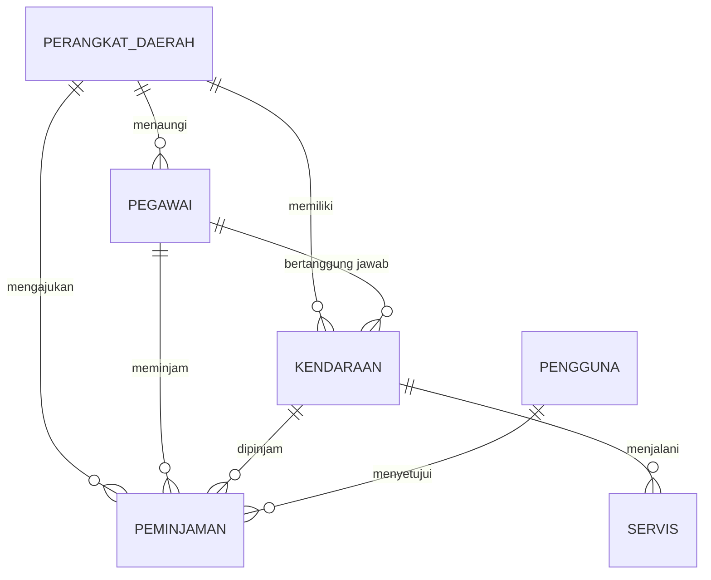

# Product Overview — Aplikasi KDO

**Nama produk:** KDO (Kendaraan Dinas Operasional)
**Jenis:** Aplikasi web internal pemerintah daerah
**Versi dokumen:** 1.0
**Tanggal:** 10 November 2026
**Status:** Draft untuk ujian praktik Junior Programmer BPAD

---

## 1. Ringkasan

KDO adalah aplikasi web untuk mengelola kendaraan dinas operasional milik pemerintah
daerah, mulai dari pendataan aset kendaraan, keterkaitannya dengan pegawai dan perangkat
daerah, proses peminjaman, hingga riwayat perawatan.

Saat ini pencatatan kendaraan dinas umumnya dilakukan manual di buku register atau
spreadsheet terpisah. Akibatnya data mudah tidak sinkron, kondisi kendaraan tidak
terpantau, dan riwayat pemakaian sulit ditelusuri saat dibutuhkan untuk pemeriksaan.

Aplikasi ini menyatukan seluruh data tersebut dalam satu sistem dengan hak akses berjenjang,
sehingga pengelolaan aset kendaraan menjadi lebih tertib dan dapat dipertanggungjawabkan.

---

## 2. Latar Belakang & Masalah

| Masalah | Dampak |
| --- | --- |
| Data kendaraan tersebar di banyak file | Sulit mengetahui jumlah dan kondisi aset secara keseluruhan |
| Peminjaman dicatat manual | Bentrok jadwal, kendaraan dipakai tanpa izin, bukti pemakaian lemah |
| Riwayat servis tidak terdokumentasi | Biaya perawatan tidak terkontrol, kerusakan berulang tidak terdeteksi |
| Data pegawai dan perangkat daerah tidak terhubung | Sulit mengetahui siapa penanggung jawab suatu kendaraan |
| Rekap untuk pimpinan dibuat manual | Laporan lambat dan rawan salah hitung |

---

## 3. Tujuan

1. Menyediakan **satu sumber data** untuk seluruh kendaraan dinas operasional.
2. Mencatat **peminjaman dan pengembalian** kendaraan secara tertib, termasuk persetujuan.
3. Mendokumentasikan **riwayat servis dan biaya perawatan** per kendaraan.
4. Menghubungkan kendaraan dengan **pegawai** dan **perangkat daerah** yang bertanggung jawab.
5. Menyajikan **ringkasan kondisi aset** untuk pengambilan keputusan pimpinan.

### Indikator keberhasilan

| Indikator | Target |
| --- | --- |
| Seluruh kendaraan dinas tercatat | 100% kendaraan operasional masuk sistem |
| Peminjaman tercatat dengan persetujuan | 100% peminjaman memiliki status yang jelas |
| Riwayat servis terdata | Setiap servis baru tercatat beserta biayanya |
| Waktu penyusunan rekap | Dari hitungan jam menjadi < 5 menit (export CSV) |

---

## 4. Pengguna & Peran

| Peran | Deskripsi | Kebutuhan utama |
| --- | --- | --- |
| **Admin** | Pengelola sistem di bagian umum/aset | Kelola semua data master, akun pengguna, dan konfigurasi |
| **Operator** | Staf yang mendata kendaraan & peminjaman | Input/edit data kendaraan, pegawai, peminjaman, servis |
| **Pimpinan** | Kepala bagian/badan | Melihat dashboard, menyetujui atau menolak peminjaman |

### Hak akses

| Aktivitas | Admin | Operator | Pimpinan |
| --- | --- | --- | --- |
| Melihat dashboard & data | Ya | Ya | Ya |
| CRUD perangkat daerah | Ya | Ya | Tidak |
| CRUD pegawai | Ya | Ya | Tidak |
| CRUD kendaraan | Ya | Ya | Tidak |
| Mengajukan peminjaman | Ya | Ya | Tidak |
| Menyetujui/menolak peminjaman | Ya | Tidak | Ya |
| Mencatat servis | Ya | Ya | Tidak |
| Export CSV | Ya | Ya | Ya |
| Manajemen akun pengguna | Ya | Tidak | Tidak |

---

## 5. Ruang Lingkup

### Termasuk dalam lingkup

- Pendataan **perangkat daerah** (instansi/OPD).
- Pendataan **pegawai negeri sipil** beserta jabatan dan golongan.
- Pendataan **kendaraan dinas** beserta dokumen pajak/STNK.
- **Peminjaman kendaraan** dengan alur persetujuan.
- **Riwayat servis** dan biaya perawatan.
- **Dashboard** ringkasan aset dan biaya.
- **Pencarian, filter, dan export CSV**.
- **Login dan hak akses** berbasis peran.

### Di luar lingkup

- Aplikasi mobile native.
- Pelacakan GPS dan integrasi IoT kendaraan.
- Notifikasi WhatsApp/email otomatis.
- Upload dan penyimpanan file dokumen (foto cukup berupa tautan).
- Integrasi e-Office, SIMPEG, atau sistem akuntansi daerah.
- Single sign-on pemerintah.

---

## 6. Fitur Utama

### 6.1 Manajemen Perangkat Daerah

Mencatat instansi pemilik kendaraan dan tempat pegawai bertugas.

- Data: kode instansi, nama, singkatan, alamat, telepon, email, nama kepala.
- Pencarian berdasarkan nama/kode, filter status aktif.
- Tidak dapat dihapus jika masih memiliki pegawai atau kendaraan.

### 6.2 Manajemen Pegawai (PNS)

Mencatat pegawai yang bertugas dan dapat menjadi penanggung jawab kendaraan.

- Data: NIP, nama dan gelar, jabatan, golongan/pangkat, perangkat daerah, kontak.
- Validasi NIP 18 digit dan unik.
- Filter berdasarkan perangkat daerah, golongan, dan status kepegawaian.

### 6.3 Manajemen Kendaraan Dinas

Inti aplikasi: mendata seluruh kendaraan operasional.

- Data: nomor polisi, nomor rangka/mesin, merek, tipe, tahun produksi, warna, jenis,
  bahan bakar, kapasitas mesin, odometer, kondisi, status, tanggal pajak/STNK,
  perangkat daerah pemilik, dan penanggung jawab.
- Kondisi: `baik`, `rusak ringan`, `rusak berat`.
- Status: `tersedia`, `digunakan`, `perbaikan`, `dihapuskan`.
- Pencarian nomor polisi, filter kondisi/status/jenis/perangkat daerah.

### 6.4 Peminjaman Kendaraan

Mencatat penggunaan kendaraan agar tidak bentrok dan dapat dipertanggungjawabkan.

- Pengajuan berisi keperluan, tujuan, waktu mulai, dan waktu selesai.
- Sistem menolak pengajuan jika kendaraan tidak tersedia atau jadwalnya beririsan.
- Pimpinan/admin menyetujui atau menolak.
- Status kendaraan otomatis berubah mengikuti status peminjaman.
- Setelah selesai, kendaraan kembali berstatus tersedia.

### 6.5 Riwayat Servis

Mendokumentasikan perawatan kendaraan.

- Data: tanggal, jenis servis (rutin/perbaikan/ganti part), deskripsi, bengkel,
  biaya, dan odometer saat servis.
- Total biaya per kendaraan dan per bulan tampil di dashboard.

### 6.6 Dashboard

Ringkasan untuk pimpinan dan operator:

- Jumlah kendaraan per kondisi dan status.
- Jumlah kendaraan per perangkat daerah.
- Peminjaman aktif dan yang menunggu persetujuan.
- Tren biaya servis bulanan.

### 6.7 Export & Laporan

- Export CSV data kendaraan, pegawai, dan peminjaman.
- Data mengikuti filter yang sedang aktif.

---

## 7. Alur Bisnis Utama

### Alur peminjaman kendaraan

```
Operator mengajukan peminjaman
        │
        ▼
Sistem cek status kendaraan + bentrok jadwal
        │
        ├── tidak valid ──► pengajuan ditolak sistem (pesan jelas)
        ▼
Status: DIAJUKAN  (kendaraan masih tersedia)
        │
        ▼
Pimpinan/Admin meninjau
        │
        ├── tolak ──► Status: DITOLAK
        ▼
Status: DISETUJUI  (kendaraan menjadi DIGUNAKAN)
        │
        ├── batal ──► Status: DIBATALKAN (kendaraan kembali TERSEDIA)
        ▼
Kendaraan dikembalikan → Status: SELESAI (kendaraan TERSEDIA)
```

### Alur perawatan

1. Operator mencatat servis (tanggal, jenis, biaya).
2. Jika kendaraan harus masuk bengkel, status diubah menjadi `perbaikan`.
3. Setelah selesai, status dikembalikan ke `tersedia`.
4. Biaya servis otomatis masuk ke ringkasan dashboard.

---

## 8. Model Data Konseptual



| Entitas | Peran dalam bisnis |
| --- | --- |
| Perangkat Daerah | Pemilik kendaraan dan unit kerja pegawai |
| Pegawai | Pengguna kendaraan dan penanggung jawab aset |
| Kendaraan | Aset yang dikelola |
| Peminjaman | Catatan penggunaan kendaraan |
| Servis | Catatan perawatan dan biaya |
| Pengguna | Akun login dengan peran tertentu |

---

## 9. Aturan Bisnis Ringkas

1. NIP harus 18 digit dan tidak boleh ganda.
2. Nomor polisi harus unik dan ditulis seragam (huruf kapital).
3. Tahun produksi tidak boleh melebihi tahun berjalan + 1.
4. Kendaraan hanya bisa dipinjam jika berstatus `tersedia`.
5. Jadwal peminjaman yang beririsan otomatis ditolak.
6. Menyetujui peminjaman mengubah status kendaraan menjadi `digunakan`.
7. Kendaraan dengan peminjaman aktif tidak dapat dihapus.
8. Perangkat daerah yang masih memiliki data terkait tidak dapat dihapus.
9. Data yang dihapus tidak hilang permanen (soft delete) untuk keperluan audit.

---

## 10. Kebutuhan Non-Fungsional

| Aspek | Kebutuhan |
| --- | --- |
| Kemudahan pakai | Antarmuka berbahasa Indonesia, alur input maksimal 2 langkah |
| Performa | Halaman list merespons < 1 detik untuk 1.000 data |
| Keamanan | Password ter-hash, akses berbasis peran, token kedaluwarsa |
| Keandalan | Data tersimpan di database relasional dengan transaksi |
| Kompatibilitas | Browser modern (Chrome/Edge/Firefox), layar ≥ 768px |
| Pemeliharaan | Kode terstruktur per lapisan, konfigurasi lewat environment |
| Audit | Setiap data mencatat waktu dibuat dan diubah |

---

## 11. Asumsi & Ketergantungan

- Aplikasi dijalankan di jaringan internal dan diakses lewat browser.
- Data awal kendaraan dan pegawai diisi manual atau lewat seed.
- Satu kendaraan dimiliki satu perangkat daerah.
- Satu peminjaman hanya untuk satu kendaraan.
- Persetujuan peminjaman dilakukan di dalam aplikasi, bukan lewat surat fisik.
- Tidak ada integrasi otomatis dengan sistem kepegawaian atau akuntansi.

---

## 12. Glosarium

| Istilah | Arti |
| --- | --- |
| **KDO** | Kendaraan Dinas Operasional |
| **Perangkat Daerah** | Organisasi perangkat daerah (dinas/badan/kantor) |
| **PNS** | Pegawai Negeri Sipil |
| **NIP** | Nomor Induk Pegawai, 18 digit |
| **Golongan** | Tingkat kepangkatan PNS (I/a–IV/e) |
| **STNK** | Surat Tanda Nomor Kendaraan |
| **Soft delete** | Data ditandai terhapus, tidak dihapus permanen |
| **Peminjaman aktif** | Peminjaman berstatus diajukan atau disetujui |

---

## 13. Riwayat Dokumen

| Versi | Tanggal | Perubahan |
| --- | --- | --- |
| 1.0 | 10 Nov 2026 | Draft awal untuk ujian praktik |
